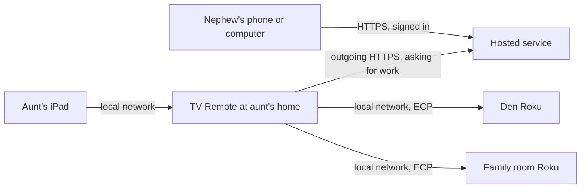

# Family accounts: design

**Status:** Phase 1 is built, in [`hub/`](../hub/README.md) and TV Remote's Family account setting.
Choices made while building:
- **Language:** Python, using the standard library only, with SQLite. It's the same style as TV
  Remote.
- **Sign-in:** email and password, stored as salted PBKDF2 hashes. The owner's account is made on the
  setup page. Everyone else joins only through an invite link, where they choose their password.
  Owners make one-time reset links for forgotten passwords. (Emailed codes were tried first, but
  Hotmail filtered them, and a sending Gmail account added setup.)
- **Home connection:** HTTPS long polling instead of a WebSocket. The home asks the hub for work, and
  the hub holds the request open for up to 25 seconds until something arrives. It reacts just as
  quickly, needs no extra packages, and passes through Caddy unchanged.
- **Roles:** helper and owner. Viewer is left for later.
- **Not built yet:**
  - starting with Windows
  - live TV status
  - offline alerts
  - the hub sending alert emails
  - Phase 3
**Goal:** let family members control and set up a relative's TVs from anywhere, without changing how
that relative uses TV Remote.

---

## 1. The scenario

- **The aunt** uses TV Remote at home, on her iPad or computer, exactly as she does today. She never
  signs in to anything.
- **The nephew** lives in another state. He signs in to a TV Remote website, picks **Aunt's home**,
  and sees her remote: her TVs, channel buttons and schedules. Pressing a button there plays it on
  *her* TV, never his.
- If the nephew also uses TV Remote for his own Rokus, that's a second home in his account. A switcher
  shows which home he's controlling.

```
Nephew's account
 ├─ My home        → his own Rokus
 └─ Aunt's home    → her Rokus, through the hosted service
```

## 2. The pieces

| Piece | Where it runs | What it does |
|---|---|---|
| **TV Remote at home** | The aunt's always-on computer: the Windows app, or the website server | Controls her Rokus, as it does today. Adds an outgoing connection to the hosted service. |
| **Hosted service** | A cloud host | Accounts, homes, invites, and passing helpers' requests to the right home |
| **Hosted website** | Served by the hosted service | The same remote page as today, with sign-in and a home switcher |

The aunt's iPad keeps using the page served by TV Remote on her own network, so it still works if
her internet is down.



**Outgoing only:** her home connects *out* to the service and keeps that connection open. Her router
doesn't change, no ports are opened, and nothing on the internet can connect to her computer directly.

## 3. Recommended approach: relay the existing API

TV Remote's page already does everything through its own API, such as `/api/channels/play`,
`/api/schedules/save` and `/api/settings`. Rather than building a second version of every feature,
the hosted service **passes those same API requests through to the home**:

1. The nephew's browser loads the remote page from the hosted website, with **Aunt's home** chosen.
2. The page calls, for example, `POST /homes/{homeId}/api/channels/play`.
3. The service checks that he's a member of that home and that his role allows that request.
4. The service sends the request down her home's open connection.
5. TV Remote at her house runs it through the same code that handles local requests, and sends the
   answer back.
6. The service returns that answer to the nephew's browser.

**Why this approach:**
- One page and one set of features. Anything added to TV Remote works remotely straight away.
- The home stays the single source of truth for TVs, channels and schedules. There's no copy to keep
  in sync, and no conflicts to resolve.
- The hosted service stays small. It handles accounts and passes messages, but has no Roku code.

**The trade-off:** while her home is offline (computer off, or internet down), helpers can't see or
change her setup. They couldn't control her TVs then anyway, so for this use that's acceptable.
[Phase 3](#9-build-order) adds a cloud copy if it ever matters.

### Message format on the home connection

From the service to the home:
```json
{ "type": "request", "id": "c81f…", "user": "Nephew", "role": "helper",
  "method": "POST", "path": "/api/channels/play", "body": { "ip": "192.168.1.183", "id": "metv" } }
```
From the home back to the service:
```json
{ "type": "response", "id": "c81f…", "status": 200, "body": { "stopped": false, "verified": true } }
```
The home also sends:
- **Every 30 seconds,** a heartbeat with each TV's status: on or off, the active app, and whether
  something is playing. This gives helpers a live view.
- **When an event happens,** a notice such as "schedule ran" or "button failed".

**Rules:**
- **Each request has a unique `id`**, so a retried request is never acted on twice.
- **The service waits up to 60 seconds for an answer**, since a channel button can take 30 or more.
  After that, it tells the helper the home didn't respond.
- **The home only accepts paths on its allowlist** (see [Security](#7-security)), even if the
  service sends something else. A compromised service still can't do more than a helper could.

## 4. Data in the hosted service

Small, and none of it is TV or channel data.

| Table | Fields |
|---|---|
| **Users** | id, name, email, sign-in provider id |
| **Homes** | id, name (like "Aunt's home"), created by |
| **Members** | home id, user id, role (`owner`, `helper` or `viewer`), added by, added on |
| **Invites** | home id, role, one-time code, expires at, used by |
| **Home connections** | home id, device token hash, paired on, last seen, TV Remote version |
| **Activity** | home id, user id, time, what was done (like "Played MeTv on Den"), result |
| **Alert recipients** | home id, email addresses (see [Alerts](#8-alerts-improve-too)) |

## 5. Roles

| Role | Can |
|---|---|
| **Viewer** | See the remote, TV status, schedules and activity. Can't press or change anything. |
| **Helper** | Everything a viewer can, plus press buttons, play channels, start over, and add, edit or delete channel buttons and schedules |
| **Owner** | Everything a helper can, plus invite or remove people, change roles, remove TVs, change the lock, change alert settings, and disconnect the home |

A home can have several owners. You'd typically be the owner of your aunt's home, and invite other
relatives as helpers.

## 6. What changes for each person

### The aunt
- Nothing she has to learn. Her screen, buttons and lock work as they do today.
- When a helper presses something, a banner appears on her screen for a few seconds, like
  **"Your nephew is helping: playing MeTv"**, so the TV changing by itself doesn't alarm her.

### TV Remote at her house
- A new **Family account** section in Settings: **Connect to family account**. It shows a six-digit
  code, and an owner enters that code on the hosted website to link this home to their account. To
  stop all remote access, choose **Disconnect**.
- **Starts with Windows,** and warns if the computer is set to sleep. It has to stay running to
  receive helpers' requests and play schedules.
- The connection reconnects by itself after internet drops, waiting a little longer between each try.

### The nephew
- Signs in on the hosted website. There's nothing to install, and it works on a phone.
- Opens an invite link once to join **Aunt's home**.
- Sees the same remote as today, plus:
  - a **home switcher**
  - a **"Controlling: Aunt's home"** header
  - each TV's live status
  - an **Activity** list
- His own Rokus, if he has any, are a separate home. TV Remote at his house connects to his account
  the same way.

## 7. Security

This controls devices in someone's home, so it's designed to fail closed.

- **Sign-in through a trusted provider,** such as Microsoft, Google, or emailed one-time codes. The
  service never stores passwords.
- **Linking a home needs physical access:**
  - The six-digit code appears only on the home computer.
  - It expires after 10 minutes and works once.
  - Linking gives the home a long random device token. The service stores only a hash of it.
- **Every request is checked twice:**
  - The service checks the user's membership and role for that home.
  - The home checks its own allowlist of paths and methods, by role.
- **Owner-only requests** include `/api/tvs/remove`, `/api/lock` and `/api/alerts`.
- **Never relayed**, whatever the role: TV discovery, which scans her network, and the export and
  import file transfers.
- **Rate limits** apply per user and per home, so a stuck script can't flood her TVs.
- **An activity log** records who did what and when, and every member of the home can see it.
- **Access can be removed:** an owner can remove a helper at once, and the home can disconnect from
  its own Settings, ending all remote access.
- **The lock PIN stays local.** Remote helpers are checked by their account and role, not the PIN.
- **The Gmail app password moves to the service** (see below), so her computer no longer stores an
  email password in plain text.

## 8. Alerts improve too

Today, TV Remote can't email anyone if it stops running or her internet goes down. With a hosted
service:

- **"Home offline" alerts:** if her home misses heartbeats for 15 minutes, the service emails the
  members. It sends once, then once more when the home comes back.
- **The service sends alert emails** for button failures that the home reports. The home no longer
  needs an email account or password.
- Alert recipients are managed on the hosted website by owners.

## 9. Build order

**Phase 1: remote control (the core)**
1. Hosted service:
   - sign-in
   - homes, members and invites
   - pairing a home with a code
   - the relay, with per-role checks
   - the activity log
2. TV Remote:
   - **Connect to family account**
   - the outgoing connection and request handler, using the existing API with its allowlist
   - start with Windows
   - the "is helping" banner
3. Hosted website:
   - the existing page with sign-in
   - the home switcher, which is effectively the existing page pointed at `/homes/{id}`
   - the "Controlling" header

**Phase 2: better awareness**
1. Live TV status from heartbeats.
2. "Home offline" alerts, with the service sending all alert emails.
3. Activity list in the page.

**Phase 3: optional**
1. A cloud copy of each home's channels and schedules, so helpers can edit while the home is offline,
   with changes applied when it reconnects.
2. A shared button library: buttons for an app that one family member records can be offered to
   other homes. This is the maintainer manifest idea.

## 10. Hosting and cost

| | Option A: Python | Option B: .NET |
|---|---|---|
| **Service** | FastAPI with WebSockets | ASP.NET Core with SignalR |
| **Database** | PostgreSQL | PostgreSQL or Azure SQL |
| **Sign-in** | Auth0, Clerk, or emailed codes | Microsoft Entra External ID |
| **Host** | Render, Fly.io or Railway | Azure App Service |
| **Rough cost** | About $5–15 a month | About $15–30 a month |
| **Fits because** | Same language as TV Remote, and shares its code | Strong fit if you prefer C# and Azure. A Blazor UI is possible, but the relay approach reuses the existing page instead. |

With either cloud host, a custom domain costs about $10–15 a year. All traffic is HTTPS and WSS,
whichever option is used.

### Option C (current plan): self-hosted on a UGREEN NAS

The service runs in Docker on the UGREEN NAS, at a different house from the aunt's. It's reached
through the existing **No-IP name** for that house, with the router forwarding to a **Caddy**
container:

```
Helper, or TV Remote at aunt's house (outgoing HTTPS)
  → yourname.ddns.net:8443
  → router at the NAS's house
  → Caddy container (HTTPS)
  → service container, over the NAS's private Docker network
```

**How each part fits:**
- **No-IP keeps the name pointing at the house,** whose address isn't static. Its updater is already
  set up and has worked for years. Everything connects by name, so an address change only causes a
  few minutes' gap, and the aunt's TV Remote reconnects on its own.
- **Caddy is the only thing reachable from outside.** It gets a free Let's Encrypt certificate for the
  No-IP name and renews it automatically. It passes requests to the service over a private network.
- **HTTPS is required:** it protects sign-ins, the home token and commands. Google and Microsoft
  sign-in also need it.
- **Port 8443 carries the service.** Port 80 is forwarded to Caddy only so Let's Encrypt can check
  the name when issuing and renewing the certificate. Caddy redirects anything else on port 80.

**Router settings at the NAS's house:**

| External port | Forward to | Purpose |
|---|---|---|
| 8443 (TCP) | NAS, Caddy's port 8443 | The service, over HTTPS |
| 80 (TCP) | NAS, Caddy's port 80 | Certificate checks only |

Turn off **UPnP** on the router and the NAS, so nothing else opens ports without you knowing. Check
that the router's WAN address matches the public address shown by a site like whatismyip.com. If it
doesn't, the connection is behind CGNAT and forwards won't arrive.

**Containers**, as one Compose project in UGOS Pro's Docker app:

As built, it's **one image** containing the hub and Caddy, made on a PC by
[`hub/build-image.ps1`](../hub/build-image.ps1) and imported in UGOS Pro's Docker app. See
[hub/README.md](../hub/README.md).

- **Settings aren't in the image.** They're entered on a setup page (port 8080, home network only,
  protected by a setup password) and saved in `/data`. The hub then starts Caddy for the No-IP
  name.
- **The container needs only** three ports (8443, 80, and 8080 for setup) and one folder mapped to
  `/data`.
- **The hub listens only inside the container,** on 127.0.0.1:8000. Caddy is the only thing
  reachable.
- **Both run as an ordinary user,** not root. The settings file can be read only by the hub.

A Compose alternative, [`hub/docker-compose.yml`](../hub/docker-compose.yml), runs the hub on the
official Python image with the code mounted in, and Caddy in a second container.

If the NAS already uses port 80 or 8443 for something of its own, map Caddy to other NAS ports, such
as `8080:80` and `9443:8443`, and point the router's forwards at those. The external ports stay 80 and
8443.

**Setup steps:**
1. On the NAS, create a shared folder for the project, with `docker-compose.yml` and `Caddyfile`,
   using the real No-IP name.
2. Create the project in UGOS Pro's Docker app and start it.
3. Add the two port forwards on the router, and turn off UPnP.
4. Open `https://yourname.ddns.net:8443` from outside the house, for example on a phone with Wi-Fi off,
   and check that it loads with a valid certificate.
5. Include the project's `data` and `caddy-data` folders in the NAS's backups.

**Keep the NAS itself safe:**
- **Forward only to Caddy,** never to the NAS admin page or other NAS apps.
- **Keep UGOS Pro and the container images updated.** Expect constant automated scanning once the
  port is open.
- **Turn on two-factor sign-in** for the NAS admin account.
- **Don't give the containers** access to the Docker socket, other shared folders, or host networking.
- **Glance at Caddy's access logs** now and then.

**What this costs:** nothing extra. The No-IP name already exists, and Let's Encrypt certificates are
free. Free No-IP names need confirming every 30 days, which is already part of the routine.

**If a port forward ever stops working**, for example after an internet provider change that adds
CGNAT, a Cloudflare Tunnel or Tailscale can reach the same containers without any forwarding. Only
this network setup would change, not the service.

**Trade-off:** remote help depends on the NAS's house having power and internet. If it's down,
helpers can't reach the aunt's TVs, but her own buttons and schedules keep working, because they run
at her house.

## 11. Decisions needed before building

1. **Decided: Python** for the hosted service.
2. **Decided: email and password** sign-in, with invite links and owner-made reset links.
3. **Decided: hosting** on the UGREEN NAS, reached through the existing No-IP name, with Caddy in the
   same container. NAS port 80 is taken by UGOS, so the container uses NAS port 8088 for it.
4. **Whether the "is helping" banner shows** the helper's name or just "Family is helping".
5. **Which computer stays on at the aunt's house**, and that it's set never to sleep.

## 12. Open risks

- **Her computer sleeping or restarting for updates** stops remote help and schedules. Mitigations:
  start with Windows, keep awake, and Phase 2's offline alerts.
- **Two people pressing at once:** the second request replaces the first, as on a single remote. The
  activity log shows what happened.
- **Confusing her:** keep the banner short and friendly, and avoid remote changes while something
  she's watching is playing, unless the helper confirms.
