# TV Remote user guide

TV Remote lets you control Roku devices from a computer, phone or tablet. Its main feature is
**channel buttons**: one tap opens a streaming app and goes to a channel, so nobody has to learn each
app's menus.

This guide covers everyday use, then setting things up for someone else, such as a relative who finds
the Roku remote hard to use.

- [Getting started](#getting-started)
- [The remote](#the-remote)
- [Channel buttons](#channel-buttons)
- [Adding and editing channels](#adding-and-editing-channels)
- [Schedules](#schedules)
- [Choosing which TVs and apps show](#choosing-which-tvs-and-apps-show)
- [Setting it up for someone else](#setting-it-up-for-someone-else)
- [Helping from anywhere](#helping-from-anywhere)
- [Settings](#settings)
- [Troubleshooting](#troubleshooting)

---

## Getting started

### Opening the remote
- **Website:** on the computer that runs it, start the server (see the main [README](../README.md)),
  then open http://localhost:8000. On a phone or tablet on the same Wi-Fi, use the address the server
  prints, such as `http://192.168.1.161:8000`.
- **Windows app:** open **TV Remote.exe**. It opens maximized and works the same way as the website.

The website and the Windows app keep separate channels and settings. Use **Export** and **Import** to
copy channels between them.

### Connecting to a TV
The first time, TV Remote searches your network and lists the Roku devices it finds. Choose one. If
yours isn't listed, make sure it's on, then type its IP address, which is shown on the Roku under
**Settings > Network > About**.

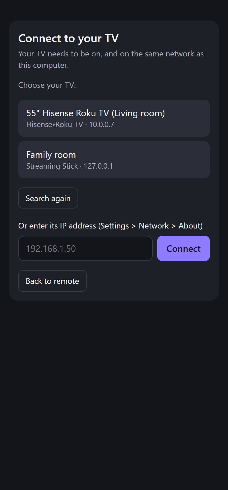

> **Before you start:** on each Roku, go to **Settings > System > Advanced system settings >
> Control by mobile apps** and choose **Permissive**. Otherwise, the Roku may refuse some commands or
> its app list.

---

## The remote

The full remote has the usual Roku buttons, plus your TVs, channel buttons, apps, a box for typing
on the TV, and settings.

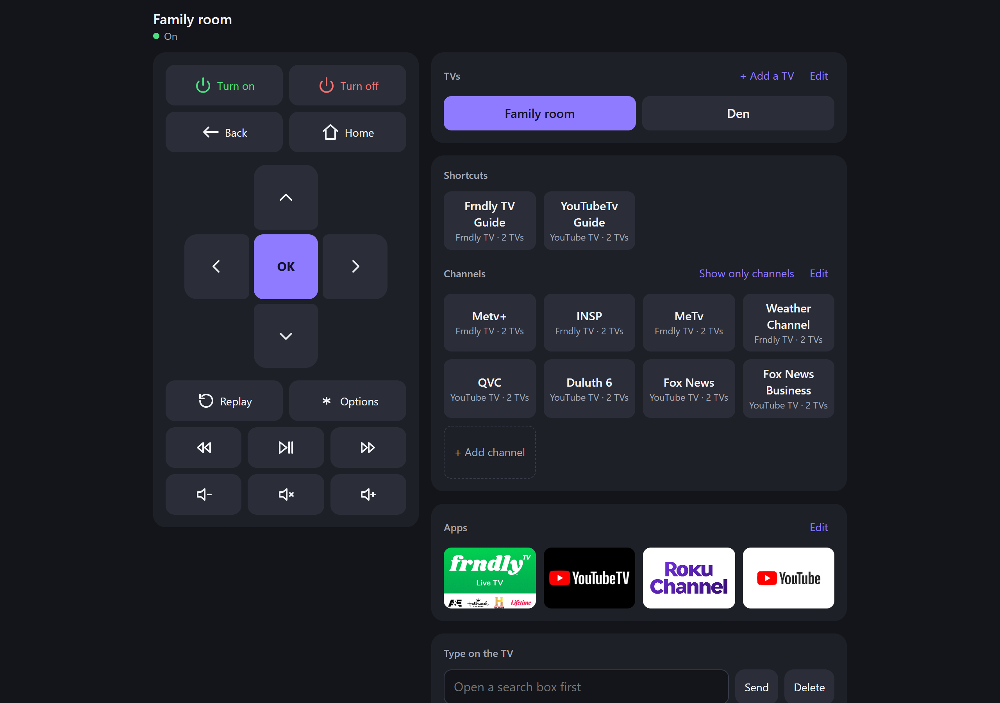

On a phone, the same sections are stacked so you can scroll through them.

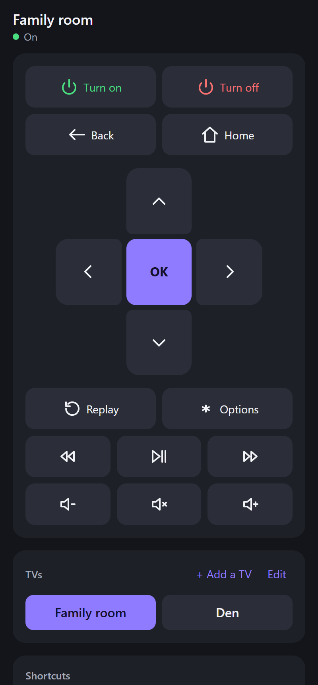

| Section | What it does |
|---|---|
| **Turn on / Turn off** | Power. These work on Roku TVs. With a Roku stick, they only control the TV if it supports HDMI-CEC. You can hide them for a TV that ignores them: see [This TV](#this-tv). |
| **Back, Home, arrows, OK** | The same as the physical remote |
| **Replay, Options, playback** | Instant replay, the star (Options) button, rewind, play/pause and fast forward |
| **Volume** | Works on Roku TVs. With a stick, it depends on the TV, the same as power, and can be hidden the same way. |
| **TVs** | Switch between your Roku devices |
| **Channels** | One-tap buttons that go to a channel. See below. |
| **Apps** | Open any app on the Roku |
| **Type on the TV** | Type into a search box that's open on the TV |

On a computer, you can also use the keyboard: arrows move, **Enter** is OK, **Backspace** is Back,
**H** is Home, **Space** is play/pause, **+** and **-** change the volume, and **M** mutes.

---

## Channel buttons

Tap a channel button, and TV Remote opens the app and presses the buttons to reach that channel.
A banner shows while it works, and **Stop** cancels it.

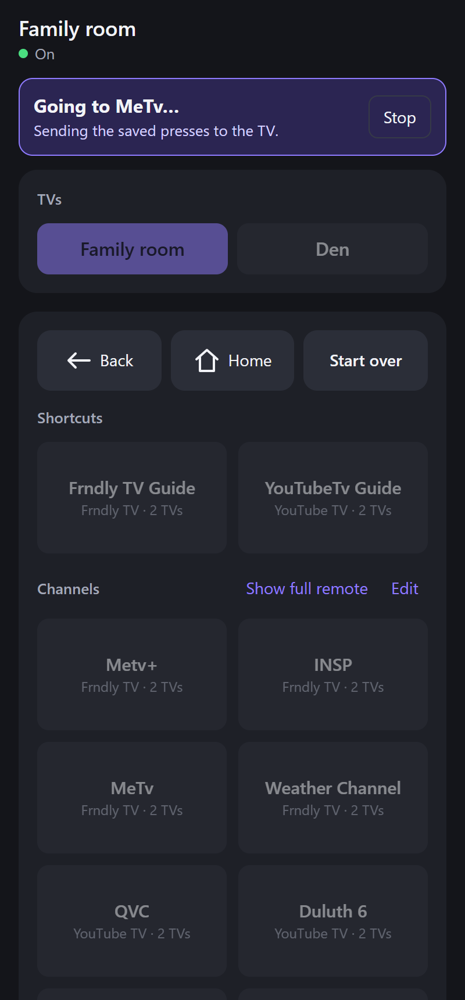

When a button finishes, TV Remote checks that video started. If nothing is playing, it shows a
message, and it emails your family if alerts are set up.

### Channels-only view
For a simpler screen, choose **Show only channels** next to the Channels heading. This hides the full
remote and leaves the TVs, **Back**, **Home**, **Start over**, shortcuts and channels. The setting stays
on until you choose **Show full remote**.

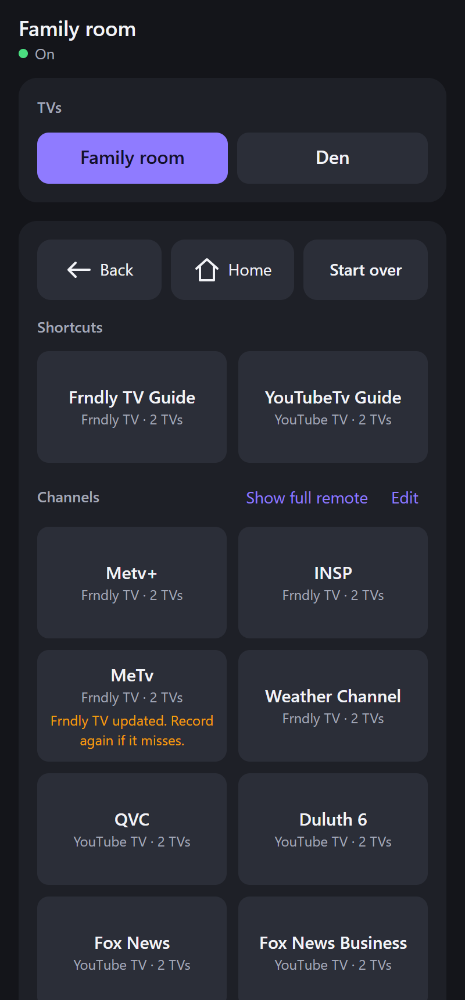

- **Start over** stops anything that's running and goes back to the Roku home screen. It's the
  button to press when something seems stuck.
- **Shortcuts** are buttons that aren't channels, such as one that opens a guide. They appear above
  the channels.

---

## Adding and editing channels

### Adding a channel by hand
1. Choose **+ Add channel**.
2. Enter a name, and choose the app the channel is in.
3. Tap the buttons under **Button presses** in the order you'd press them on the remote.
   Nothing is sent to the TV while you do this.
4. Choose **Save**, or **Save and try** to run it on the TV straight away.

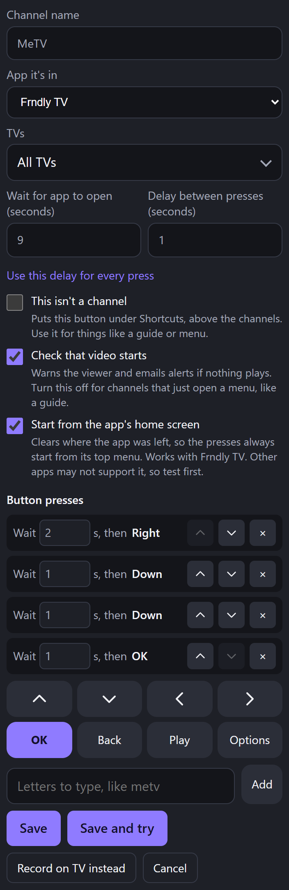

| Setting | What it means |
|---|---|
| **TVs** | Which TVs get this button. New buttons go on **All TVs**, including TVs added later. |
| **Wait after the app opens** | TV Remote first waits until the Roku reports the app open, however long that takes, then waits this long for the app's menus to load before pressing anything. Raise it if presses start too early. If the app doesn't open within 45 seconds, the button stops and reports a problem instead of pressing anyway. |
| **Delay between presses** | The wait added before each new press. Each press also has its own wait, which you can change. |
| **This isn't a channel** | Puts the button under Shortcuts, for things like a guide or menu |
| **Check that video starts** | Warns, and sends an email alert, if no video starts. Turn it off for menu buttons. |
| **Start from the app's home screen** | Resets the app before the presses, so they always start from the same place. Works with Frndly TV, so test it with other apps. |

You can also type letters, such as `metv`, to fill in an app's search box, and move or remove any
press with the arrow and **×** buttons.

### Channels that open directly (Pluto TV)
Some apps can open straight onto a channel, with no menus or button presses. For those apps, the
editor shows a **channel list** instead of button presses: search for the channel, like
`andy griffith`, and choose it. The button's name fills in from the channel, and you can change it.

The button then opens the app right on that channel, whatever was playing before, and still checks
that video starts. There's nothing to record, so these buttons don't break when the app changes its
menus.

So far this works with **Pluto TV**. Other apps, like Frndly TV and YouTube TV, use button presses.

To put a button on some TVs only, open **TVs**, uncheck **All TVs**, and check the TVs you want.
The TV you're using is always included.

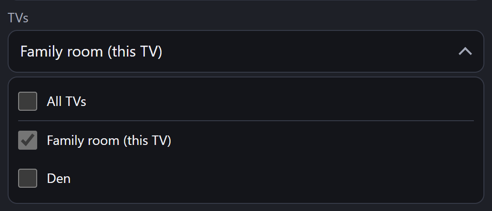

### Recording a channel instead
If you'd rather use the remote, choose **Record on TV instead**. The TV opens the app, and every button
you press on this page's remote is recorded, along with the pauses between presses. Choose **Save**
in the banner when you reach the channel.

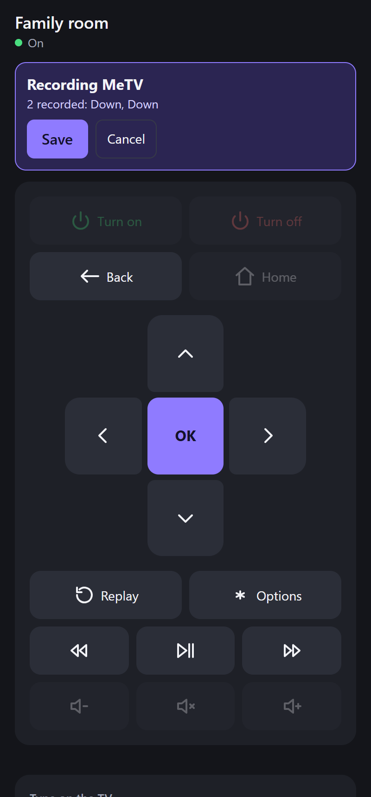

Wait until the app has fully loaded before pressing anything. Buttons that would interrupt the
recording, like Home and power, are turned off while recording.

### Editing, copying and arranging
Choose **Edit** next to the Channels heading. Each button then shows:

- **Drag to move:** rearrange buttons. With a mouse, you can also drag buttons without choosing
  Edit. Buttons stay within their own group, Shortcuts or Channels.
- **Edit name, TVs & steps:** open the editor
- **Copy:** start a new button from this one's settings
- **Record again:** replace the presses by recording them
- **Delete** or **Delete from this TV:** remove it

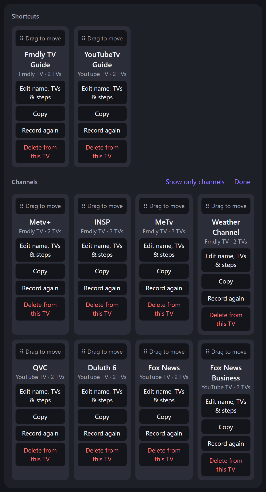

Changes to a button shared by several TVs apply on all of them.

### Tips for reliable buttons
- **Test each button from different places:** for example, after watching another channel, from
  the Roku home screen, and after restarting the Roku.
- **Test on each TV:** a button recorded on one TV may land differently on another.
- **Leave enough time:** if a button sometimes lands in the wrong place, raise the waits.
- **Re-check after app updates:** a button that misses after an update usually just needs recording
  again. TV Remote helps with this. Each button remembers the app's version on each TV when it's saved and
  whenever it plays and video starts. If the app has been updated since then, the button shows
  **"... updated. Record again if it misses."**. Playing it successfully clears the warning, and alert
  emails mention the update. The warning doesn't show in the locked view.

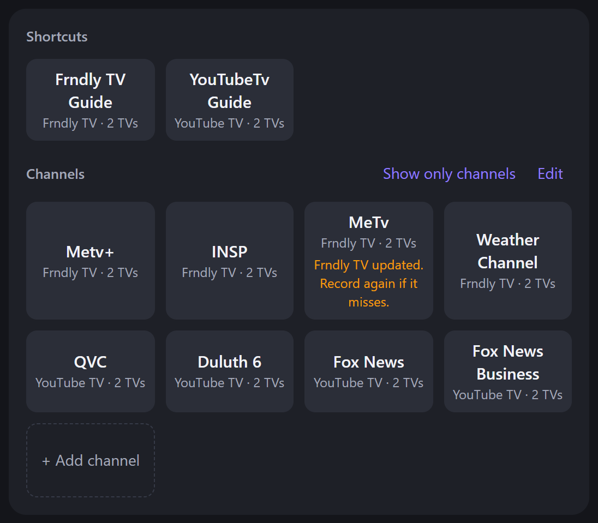

---

## Schedules

A schedule plays a channel button at a set time on chosen days, on one TV or several at once. For
example, the news every weekday morning in the living room and the den.

1. In the **Schedules** section of the full remote, choose **+ Add schedule**.
2. Choose the channel, the time and the days. **Every day**, **Weekdays** and **Weekends** fill in
   the days for you.
3. Under **TVs**, check every TV it should play on. Only TVs that have the channel can be checked.
4. Choose **Save schedule**.

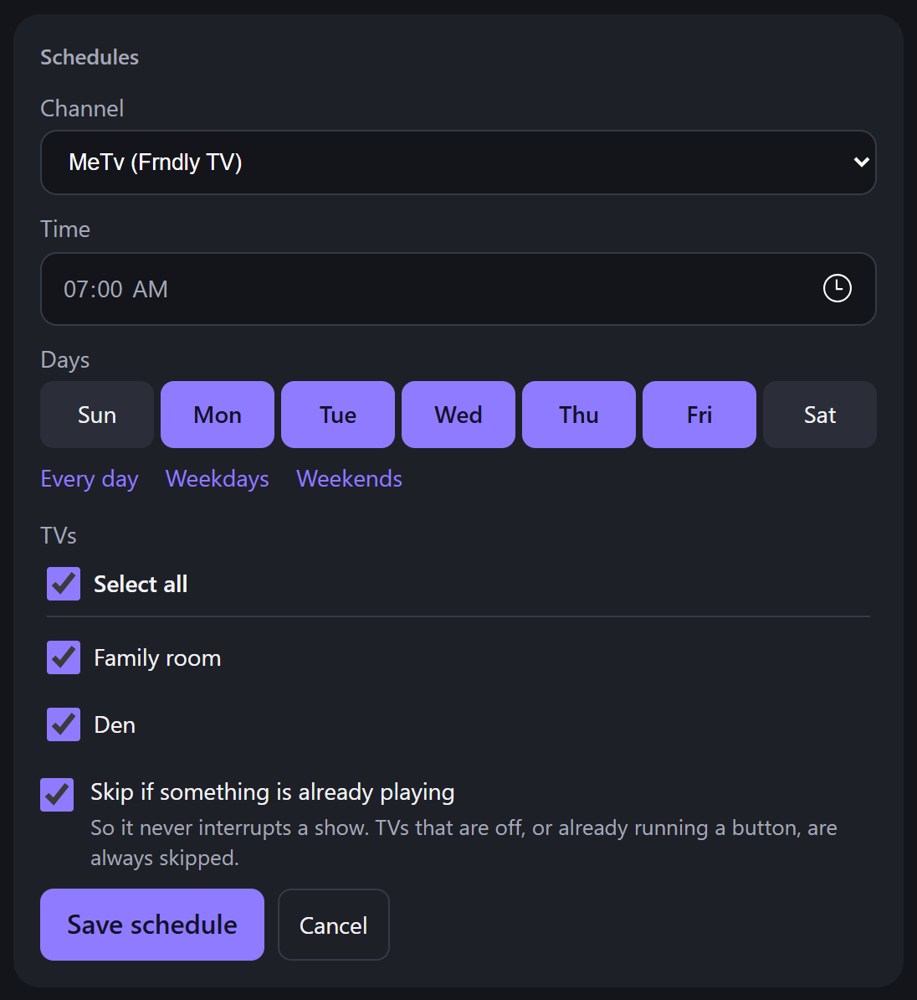

So a schedule never surprises anyone watching, it skips a TV when:
- the TV is a Roku TV that's turned off (schedules never turn a TV on)
- the TV doesn't answer, for example because its stick has no power
- another button is already running on it
- something is already playing, unless you uncheck **Skip if something is already playing**

Each schedule shows what happened on each TV the last time it ran, such as "Den: Played" or
"Family room: Skipped: something was already playing". If a scheduled button fails or no video starts,
email alerts are sent as usual. Uncheck the box next to a schedule to pause it without deleting it.

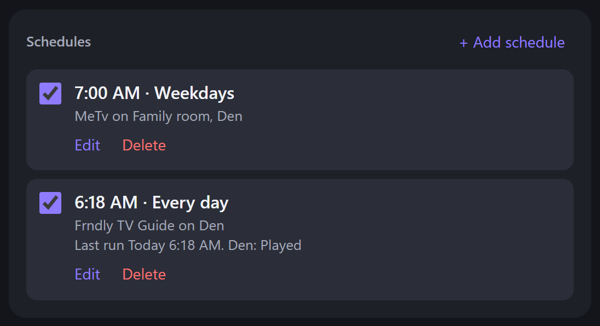

Schedules play only while TV Remote is running, on the computer that runs the website or in the
Windows app, and they use that computer's clock. The website and the Windows app keep separate
schedules, so set them up in the one that stays running.

---

## Choosing which TVs and apps show

### TVs
TV Remote remembers every Roku it finds. To remove one, choose **Edit** in the TVs section, then
**Remove**, and tap again to confirm. This removes that TV's buttons from TV Remote. Searches won't
add it back, but **+ Add a TV** will.

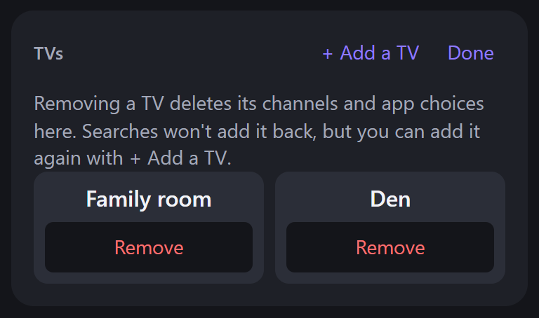

### Apps
Choose **Edit** in the Apps section, and uncheck the apps you don't want to see. **Select all** turns
every app on or off at once. This is saved for each TV. Channel buttons can still use hidden apps.

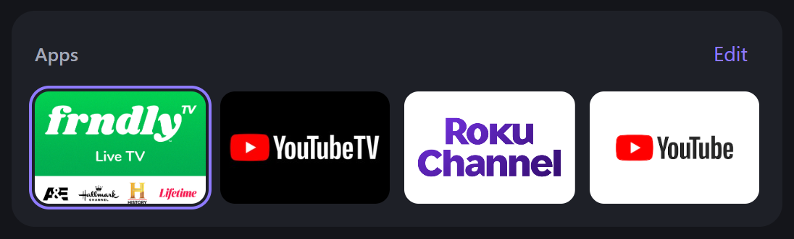 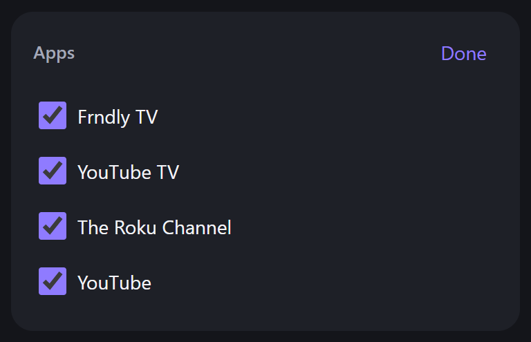

---

## Setting it up for someone else

If you're setting up TV Remote for someone who finds the Roku remote hard to use:

1. **Add a few channel buttons** for what they watch most, and test each one several times.
2. **Set up email alerts** (see [Settings](#settings)) so you hear about problems.
3. **Turn on the lock** with a PIN. Their screen then shows only big TV and channel buttons, plus
   **Back**, **Home** and **Start over**.

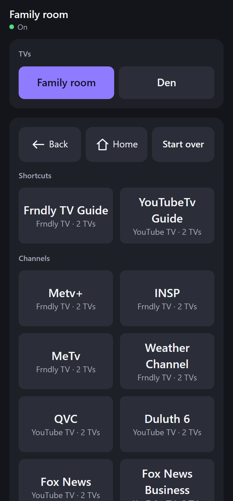

To make changes later, tap **Family: unlock** at the bottom and enter the PIN. This unlocks only
the device you're using, so their screen stays locked while you help from your own phone or
computer.

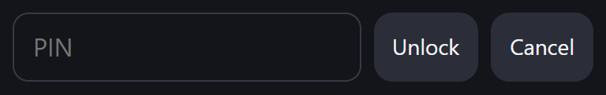

They still turn the TV on with its own remote or button, unless it's a Roku TV, which TV Remote can
turn on itself.

To help them from another house, see [Helping from anywhere](#helping-from-anywhere).

---

## Helping from anywhere

With a **family hub**, invited family members can use a relative's remote from anywhere: play
channels, press buttons, and change buttons, schedules and settings. They need nothing installed,
only a web browser on a phone, tablet or computer. Setting up the hub itself is covered in
[hub/README.md](../hub/README.md).

How it fits together:
- **At the relative's home,** TV Remote stays running on a computer that doesn't sleep. It's linked to
  the hub once, and connects out to it. Nothing changes on that home's router.
- **Everyone else** goes to the hub's address, like `https://yourname.ddns.net:8444`, and signs in
  with an email and password.

### Signing in
Open the hub's address and sign in. Each phone or computer stays signed in for 90 days.

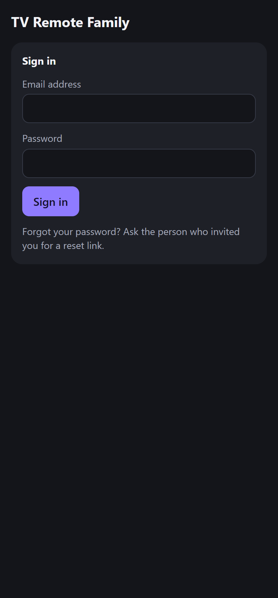

### Linking a home (once)
1. At the relative's computer, in TV Remote, open **Settings**, then **Family account**. Enter the
   hub's address and choose **Connect**. A 6-digit code appears.
2. On the hub, under **Link a home**, enter the code and a name, like "Aunt Gail's home". You become
   that home's owner.

See [Family account](#family-account) for the TV Remote side.

### Using the remote
On the hub, choose **Open remote** on the home. It's the same remote as at the home, with a purple
**Controlling** bar at the top, showing whose TVs you're controlling. If you help more than one home,
switch between them there. Everything you press happens on **their** TVs.

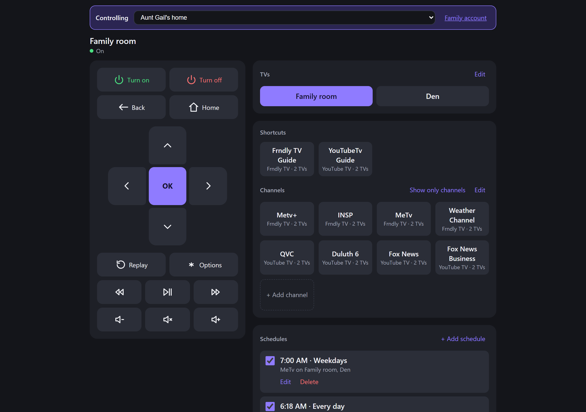

On their screen, a green note shows who's helping and what they did:

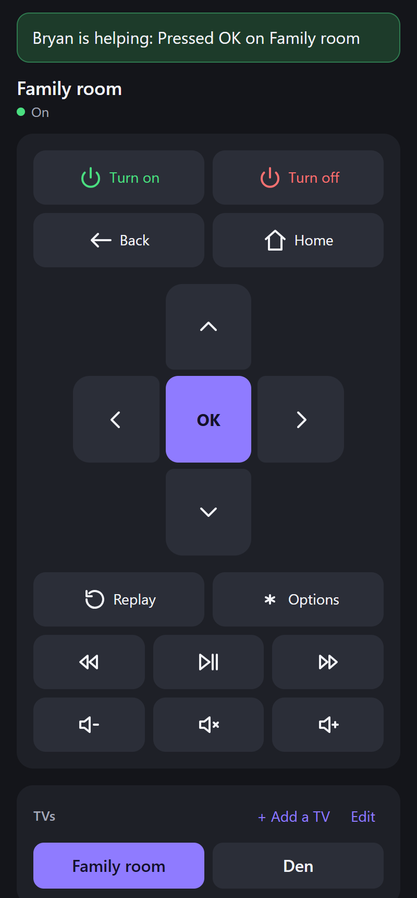

Changes made through the hub, like a new channel button or hidden apps, appear on their screen
within a few seconds, without anyone reloading it.

### Inviting family
1. On the hub, choose **Manage** on the home.
2. Under **Invite someone**, choose **Helper** or **Owner**, then **Create invite link**, then **Copy link**.
3. Send them the link by text or email. It works once, for 7 days.

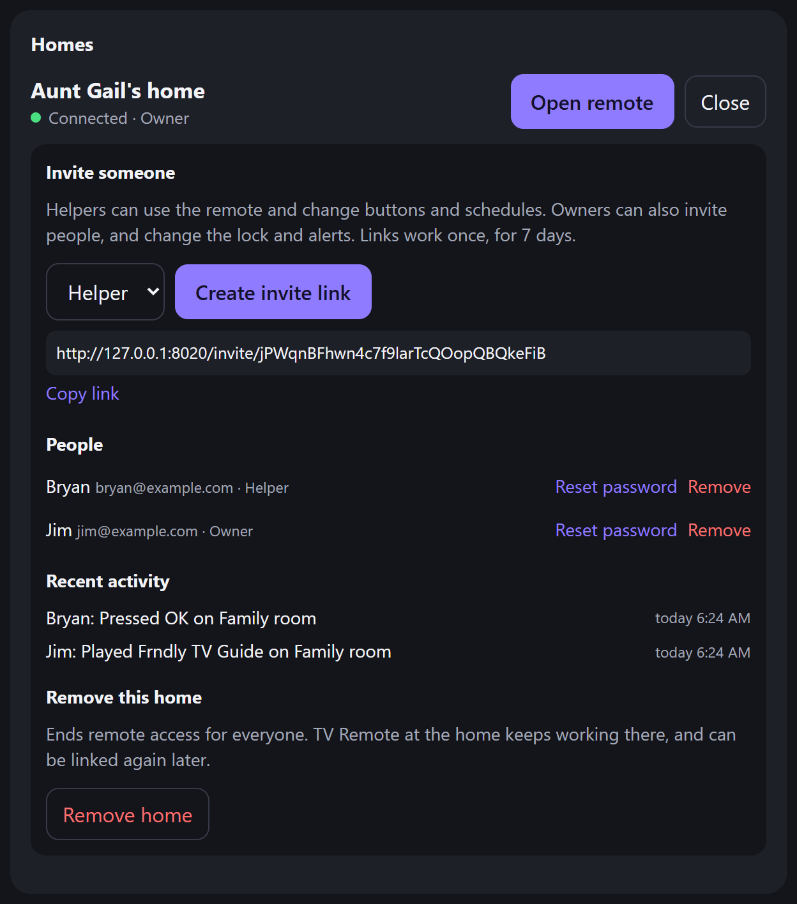

When they open the link, they enter their name and email and choose a password. After that, they sign
in with those. The name they choose is the one shown on the relative's screen.

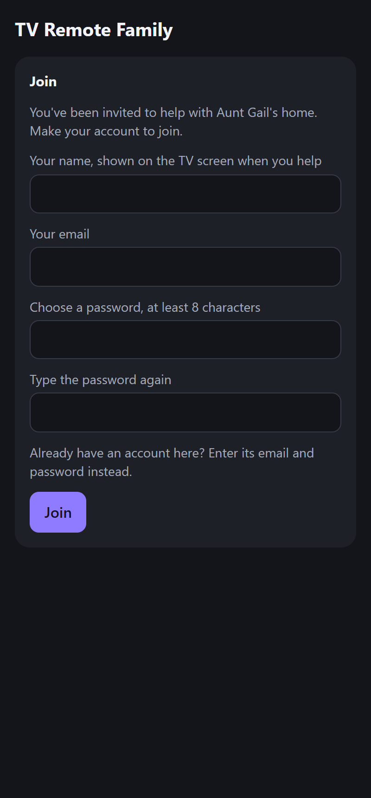

| Role | Can |
|---|---|
| **Helper** | Use the remote, play channels, and change buttons, schedules, which apps show, and power and volume |
| **Owner** | Everything a helper can, plus invite and remove people, remove TVs, change the lock and email alerts, and remove the home |

Nobody can search the home's network, export or import channel files, or change the Family account
link from the hub. Those only work at the home.

### People, passwords and activity
Under **Manage**, owners can also:
- **See recent activity,** such as "Bryan: Pressed OK on Family room".
- **Reset someone's password:** choose **Reset password** next to them, and send them the link. It
  works once, for 3 days.
- **Remove someone,** which ends their access straight away.

Anyone can change their own password with **Change password** at the top of the hub page.

---

## Settings

Settings are at the bottom of the full remote, and closed until you open them.

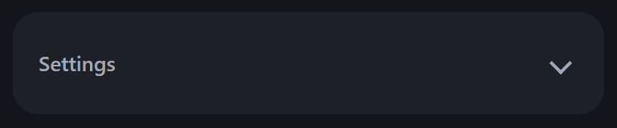

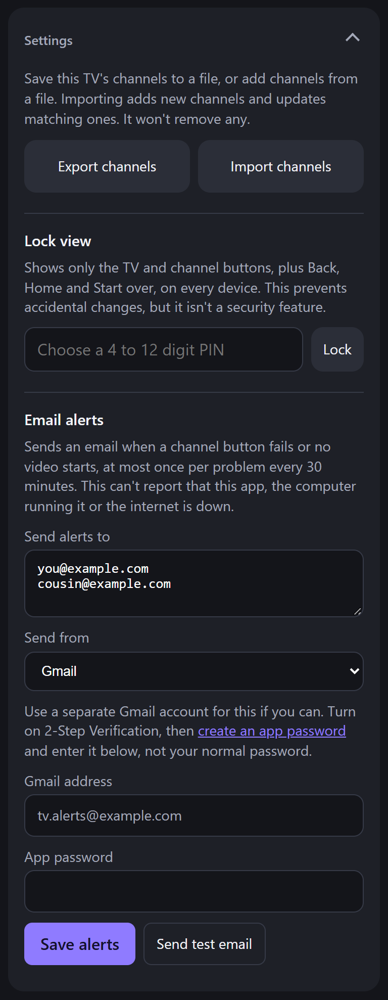

### Export and import channels
**Export channels** saves this TV's buttons to a file. **Import channels** adds buttons from a file,
updating matching ones and leaving the rest. Use this to back up buttons, or to copy them between
the website and the Windows app.

### This TV
**Show Turn on, Turn off and volume buttons** is saved separately for each TV. Roku TVs always obey
these buttons. A Roku stick or box can only control the TV if the TV supports HDMI-CEC, which older
TVs often don't, and which can't be checked automatically. So press them once on each TV. If nothing
happens, uncheck this, and the buttons are hidden for that TV.

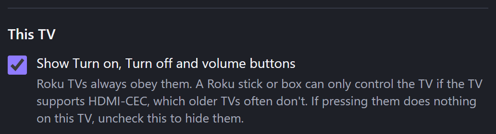

### Lock view
Choose a 4 to 12 digit PIN and choose **Lock**. To turn it off for everyone, unlock first, then choose
**Turn off lock for everyone**. The lock prevents accidental changes, but it isn't a security feature.

### Email alerts
TV Remote can email one or more people when a channel button fails or no video starts. It sends at
most one email per problem every 30 minutes.

1. Under **Send alerts to**, enter one email address per line.
2. Under **Send from**, choose **Gmail**, or **Other email account** to enter mail server details.
3. **For Gmail:** use a separate Gmail account if you can, turn on 2-Step Verification,
   [create an app password](https://myaccount.google.com/apppasswords), and enter it under
   **App password**. Don't use your normal password.
4. Choose **Send test email**, and check that it arrives, including in spam.

Alerts can't report that TV Remote itself, the computer running it, or the internet is down.

### Family account
If your family runs a TV Remote family hub, invited family members can use this remote from anywhere.
See [Helping from anywhere](#helping-from-anywhere).

1. Under **Family account**, enter the hub's address, and choose **Connect**.
2. A 6-digit code appears. Someone signed in to the hub enters it under **Link a home**, within 10
   minutes.
3. TV Remote shows **Connected**. The hub's owners can then invite other family members.

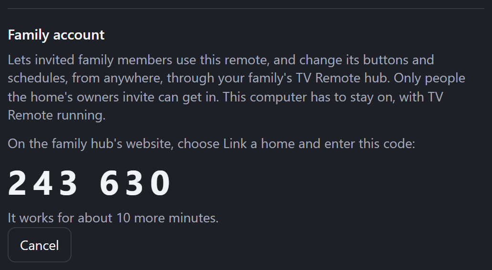

While a family member is helping, a green note at the top of the screen says who, and what they did,
like **"Nephew is helping: Played MeTv on Den"**. To end remote access, choose **Disconnect**.

This computer has to stay on, with TV Remote running, for family to reach it.

---

## Troubleshooting

| Problem | What to try |
|---|---|
| **No TVs found** | Make sure the Roku is on and on the same Wi-Fi network, not a guest network. Then try typing its IP address. |
| **"The TV refused this command"** | On the Roku, set **Control by mobile apps** to **Permissive**. |
| **Apps list shows an error** | Same as above. |
| **A channel button lands in the wrong place** | Raise **Wait after the app opens** and the delays, or record it again. For Frndly TV, turn on **Start from the app's home screen**. If the button says the app was updated, record it again. |
| **"The app didn't open within 45 seconds"** | Check that the app still opens from the Roku home screen. It may be updating, or need you to sign in again. |
| **A schedule didn't play** | Check its last run. TV Remote must be running at the scheduled time, and TVs that are off or already playing something are skipped. |
| **"Nothing seems to be playing"** | Press **Start over** and try again. If it keeps happening, the button needs fixing. For menu buttons, turn off **Check that video starts**. |
| **Turn on, Turn off or volume do nothing** | With a Roku stick, these only work if the TV supports HDMI-CEC, which can't be checked automatically. Use the TV's own remote or buttons. To hide these buttons for that TV, uncheck **Settings, then This TV, then Show Turn on, Turn off and volume buttons**. |
| **Forgot the lock PIN** | Someone with access to the computer running TV Remote can clear the lock in `settings.json`. A hub owner can also turn the lock off from the hub, without the PIN. |
| **The hub says the home "isn't connected right now"** | TV Remote at the home must be running, on a computer that's awake and online. Its **Family account** setting shows whether it's connected. |
| **Forgot your hub password** | Ask a home owner for a reset link. The hub's owner can reset their own password on the hub's setup page. |
| **An invite or reset link doesn't work** | They work once, and expire: invites after 7 days, reset links after 3. Ask for a new one. |
